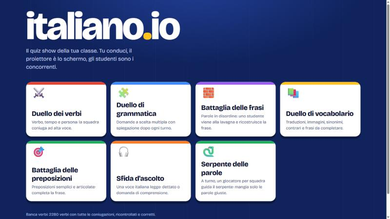
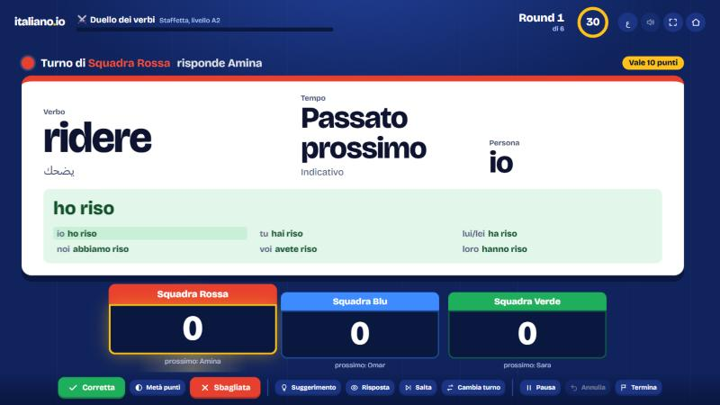
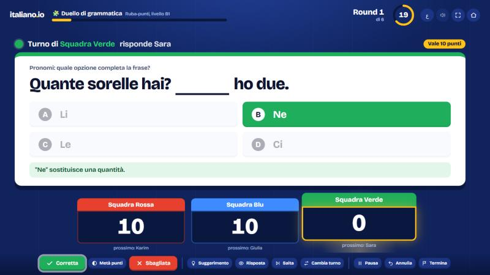
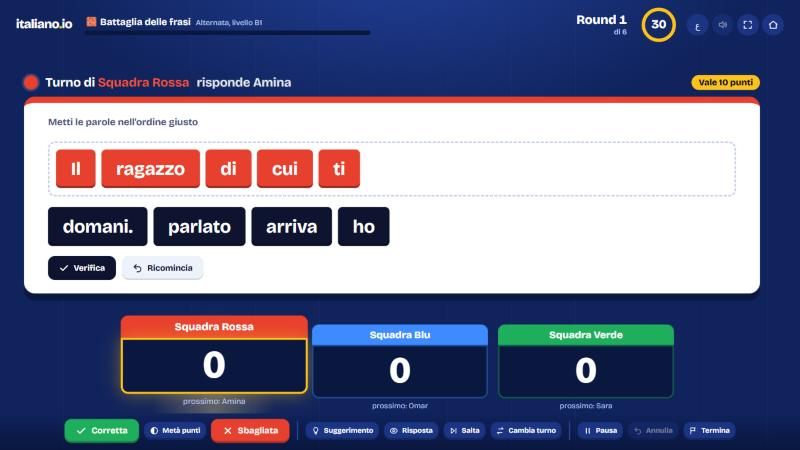
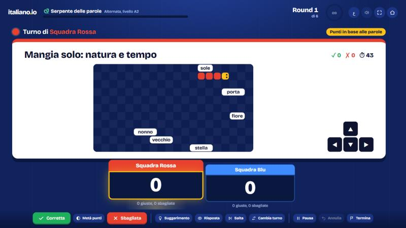
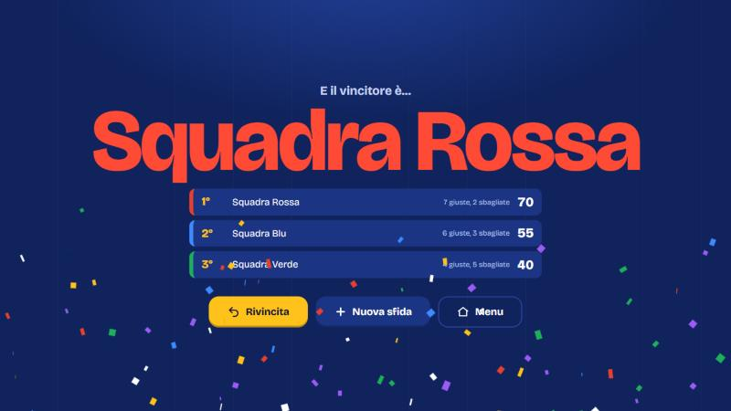

# italiano.io

**The classroom quiz show for learning Italian.** The teacher hosts, the projector is the game screen, and the students are the contestants.

italiano.io runs on one computer connected to a classroom projector. Students don't need devices, accounts or logins. Teams answer out loud, or one student comes up to the computer to play. The teacher decides whether each answer is right and controls the whole game.



---

## Contents

- [Quick start](#quick-start)
- [What a session looks like](#what-a-session-looks-like)
- [The games](#the-games)
- [Competition formats](#competition-formats)
- [Who can play](#who-can-play)
- [How turns work](#how-turns-work)
- [Teacher controls](#teacher-controls)
- [Levels A1–C2](#levels-a1c2)
- [The verb bank](#the-verb-bank)
- [Adding your own questions](#adding-your-own-questions)
- [Project structure](#project-structure)
- [Re-running the verb audit](#re-running-the-verb-audit)
- [Browser support and requirements](#browser-support-and-requirements)
- [Privacy](#privacy)
- [Guida rapida in italiano](#guida-rapida-in-italiano)

---

## Quick start

1. Download or clone the repository.
2. Open `index.html` in **Chrome** or **Edge** (double-click works; no server or install needed).
3. Plug in the projector and press **F** for full screen.
4. Pick a game, set up teams and press **Inizia la sfida**.

```powershell
git clone https://github.com/Deadlymind/italiano-io.git
```

```powershell
start .\italiano-io\index.html
```

> **Optional local server.** Some school computers block local files. You can serve the folder instead:
> `py -m http.server 5173`, then open `http://localhost:5173`.

---

## What a session looks like

1. **Setup.** The teacher picks the game, the teams, the format, the level (A1–C2), the topic, the number of rounds and an optional timer.
2. **Turns.** The screen shows whose turn it is, the question, the scores and the timer. In relay mode it also shows which student answers.
3. **Judging.** The team answers. The teacher presses **Corretta**, **Sbagliata** or **Metà punti**. Points are awarded, the answer and explanation are shown, and the turn passes to the next team.
4. **Winner.** After the last round the winner screen shows the final ranking, with confetti. One click starts a rematch with the same settings.



---

## The games

Each game has its own mechanics, built around what it teaches.

| Game | Italian name | How it plays |
|---|---|---|
| **Verb Duel** | Duello dei verbi | The screen shows a verb, a tense and a person (e.g. *ANDARE, passato prossimo, noi*). The team conjugates out loud. **Risposta** reveals the answer and the full table for that tense. Tenses get harder as the match goes on, and irregular verbs appear more often. Filters: one tense or all tenses of the level; all, regular, irregular or reflexive verbs. |
| **Grammar Duel** | Duello di grammatica | Multiple choice on 11 topics, from articles to the congiuntivo and the periodo ipotetico. When an option is chosen, the right answer turns green and an explanation appears. The hint removes two wrong options. |
| **Sentence Battle** | Battaglia delle frasi | The words of a sentence are shuffled. A student comes to the board and taps them in order, then presses **Verifica**. Two modes: **a turno** (each team gets its own sentence) or **sfida lampo** (everyone builds the same sentence; the teacher clicks the team that finished first). Sentences with more than one valid word order accept every version. |
| **Vocabulary Duel** | Duello di vocabolario | Six question types: picture → word, Italian → Arabic/English, Arabic/English → Italian, fill the gap, synonym and antonym. Synonyms and antonyms start at B1. Can be limited to one category. |
| **Preposition Battle** | Battaglia delle preposizioni | Fill in the missing preposition: simple (*di, a, da, in…*), articulated (*del, alla, negli…*) or after a verb (*decidere di, riuscire a…*). |
| **Listening Challenge** | Sfida d'ascolto | An Italian voice reads a sentence. Play it again or slow it down as often as needed. **Dettato:** teams write or repeat what they heard. **Comprensione:** a multiple-choice question about it. |
| **Word Snake** | Serpente delle parole | One student per team steers a snake with the arrow keys (or the on-screen pad) for a set time. The snake must eat only the right words: a vocabulary category, feminine or masculine nouns, forms of one tense, or irregular past participles. Right word +1, wrong word −1, crash −1. The game proposes points and the teacher confirms them. |

<p>
  
  
</p>
<p>
  
  
</p>

---

## Competition formats

| Format | Rule |
|---|---|
| **Alternata** | Teams answer one after another. A right answer earns points. |
| **Ruba-punti** | If a team answers wrong, the other teams can steal the question. The teacher clicks the team that stole it, which earns the points plus a bonus (+5). |
| **Sfida finale** | After the last round, each team bets some of its points (set with + / − under each podium). Everyone answers one hard question, from the level above. The teacher marks each team right or wrong. Winners gain their bet and losers lose it. |
| **Staffetta** | Every team member answers in turn. The screen shows who answers now and who is next. |
| **Eliminazione** | Each team has 1–5 lives. A wrong answer costs a life. At zero the team is out, and the game ends when only one team is left. |

---

## Who can play

- **Due studenti:** an individual duel between two named students.
- **Squadre:** 2, 3 or 4 teams (Rossa, Blu, Verde, Gialla). Names can be changed, and each team can list its members.
- **Tutta la classe:** paste the class list, one name per line. The class is split into 2–4 teams at random, and each turn a different student answers.

---

## How turns work

- In every round, **each active team gets exactly one turn**.
- **The team that opens each round rotates:** round 1 starts with team 1, round 2 with team 2, and so on. Nobody always goes first.
- After the teacher's verdict the answer is shown and the turn passes automatically (about 2 seconds). In setup you can choose to wait for **Avanti** instead, to leave time for discussion.
- The teacher can always **override the order**: **Cambia turno** (T), or click a team's podium and choose *Dai il turno*.
- Eliminated teams are skipped. Scores and turn order are saved after every action.

---

## Teacher controls

| Key | Button | What it does |
|---|---|---|
| **C** | Corretta | Right answer: full points |
| **M** | Metà punti | Partial answer: half points |
| **X** | Sbagliata | Wrong answer (starts the steal in Ruba-punti; costs a life in Eliminazione) |
| **H** | Suggerimento | Hint. The question is then worth half |
| **R** | Risposta | Reveal the answer and explanation |
| **S** | Salta | New question for the same team, no points |
| **T** | Cambia turno | Give the turn to another team |
| **P** / Space | Pausa | Pause the game and timer |
| **U** | Annulla | Undo the last action (up to 40 steps) |
| **Enter** | Avanti | Next turn (when manual advance is on); show the final question |
| **F** | — | Full screen |
| — | Termina | End now and go to the winner screen |

More controls:
- **Click a team's podium** to add or remove points (±1, ±5) or to give that team the turn.
- The buttons at the top right switch the **support translation** (Arabic / English / none), toggle **sound** and turn on **full screen**.
- When the teacher picks an option on the screen, the matching verdict button pulses as a suggestion. **The teacher always makes the final call.**
- If the timer runs out, a buzzer sounds and the **Sbagliata** button pulses. The teacher still decides.

---

## Levels A1–C2

The level filters every content bank. Items from the chosen level come first; when they run out, the game uses the nearest lower level. In the Verb Duel the level also sets which tenses and verbs appear:

| Level | Verb tenses | Verb pool |
|---|---|---|
| A1 | presente | 356 most frequent core verbs |
| A2 | + passato prossimo, imperfetto, futuro semplice | 468 |
| B1 | + condizionale, imperativo, trapassato prossimo | all 491 core (*fondamentali*) verbs |
| B2 | + congiuntivo presente/imperfetto, futuro anteriore, condizionale passato | 1,206 |
| C1 | + passato remoto, congiuntivo passato/trapassato | 1,986 |
| C2 | + trapassato remoto | all 2,280 |

Compound tenses are built from the bank, with the right auxiliary and participle agreement:

- *siamo andati/e*
- *si è alzato/a*
- *ce l'ho fatta*
- verbs that take either auxiliary show both forms: *ho corso / sono corso/a*

---

## The verb bank

`js/data/verbs.js` is generated from a 2,280-verb spreadsheet with English and Arabic meanings and 13 tenses per verb. The original sheet had errors, so it was audited and corrected before use:

- **1,365 cells corrected in 291 verbs.** Examples: misspelled verb stems (*somminstro → somministro*), missing *h* (*sbrigi → sbrighi*), irregular forms (*piaccono → piacciono*, *colgi → cogli*), wrong auxiliaries (*costare*, *bastare*), *-isc-* verbs labeled as regular, and accents (*battè → batté*).
- The corrected sheet is in [`data/Italian_Verb_Chart_CORRETTO.xlsx`](data/Italian_Verb_Chart_CORRETTO.xlsx). Every changed cell is highlighted, with a comment giving the old value and the reason. The **Correzioni** sheet lists all changes.
- The full report is in [`data/CORREZIONI.md`](data/CORREZIONI.md).

---

## Adding your own questions

All non-verb content is in [`js/data/content.js`](js/data/content.js), as plain JavaScript lists. **In multiple-choice items the first option is the correct one**; the game shuffles the options.

| Bank | Items | Example entry |
|---|---|---|
| `IO.GRAMMAR` | 87 | `{ l: 'B1', t: 'pronomi', q: 'Quante sorelle hai? ___ ho due.', o: ['Ne', 'Le', 'Ci', 'Li'], e: '"Ne" sostituisce una quantità.' }` |
| `IO.PREPOSITIONS` | 62 | `{ l: 'A2', k: 'a', s: 'Metti il latte ___ frigo.', a: 'nel', d: ['al', 'del', 'dal'], e: 'in + il → nel.' }` |
| `IO.VOCAB` | 104 | `{ w: 'cane', g: 'm', en: 'dog', ar: 'كلب', e: '🐕', c: 'animali', l: 'A1', s: 'Il ___ abbaia.' }` |
| `IO.SENTENCES` | 42 | `{ l: 'B1', s: 'Se piove, restiamo a casa.', alt: ['Restiamo a casa se piove.'] }` |
| `IO.LISTENING` | 22 | `{ l: 'A2', k: 'q', t: 'Testo letto…', q: 'Domanda?', o: ['Giusta', 'Sbagliata', '…', '…'] }` |

Field keys:

| Key | Meaning |
|---|---|
| `l` | Level: A1–C2 |
| `t` | Grammar topic: a key of `IO.GRAMMAR_TOPICS` |
| `k` | Preposition type (`s` simple, `a` articulated, `v` after a verb); for listening, `d` dictation or `q` question |
| `e` | Explanation shown after the answer (for vocabulary: the emoji used as the picture) |
| `g` | Noun gender (`m` / `f`) |
| `c` | Vocabulary category |
| `syn` / `ant` | Synonym and antonym (optional) |
| `alt` | Other accepted word orders for a sentence |

Write the gap as `___` in sentences. In preposition and sentence items, make sure the wrong options can't also be grammatical in context.

---

## Project structure

```
index.html                 entry point (no build step)
css/style.css              projector-friendly design
js/core.js                 utilities, synthesized sounds, confetti, timer, saving, turn manager
js/verbs-engine.js         tenses per level, compound tenses, progressive difficulty
js/games.js                the six question games
js/snake.js                Word Snake (canvas game)
js/app.js                  screens: home, setup, game, final challenge, winner; teacher controls
js/data/verbs.js           generated verb bank (2,280 verbs)
js/data/content.js         grammar, prepositions, vocabulary, sentences, listening
data/                      corrected spreadsheet and corrections report
tools/verb-audit/          scripts that audit and correct the spreadsheet
docs/screenshots/          images used in this README
```

The app is plain HTML, CSS and JavaScript. Scripts load as classic `<script>` tags, which is why opening `index.html` directly from disk works.

---

## Re-running the verb audit

Requires Python 3 with `openpyxl` (`py -m pip install openpyxl`). From the repository root:

```powershell
py tools/verb-audit/export.py "path\to\original.xlsx" rows.json
```

```powershell
py tools/verb-audit/fix.py rows.json fixed.json changes.json
```

```powershell
py tools/verb-audit/engine2.py fixed.json remaining.json
```

```powershell
py tools/verb-audit/write.py "path\to\original.xlsx" fixed.json changes.json data/Italian_Verb_Chart_CORRETTO.xlsx js/data/verbs.js
```

What each script does:

| Script | Job |
|---|---|
| `export.py` | Reads the spreadsheet into JSON |
| `fix.py` | Applies the corrections: regenerating misspelled verbs, label and auxiliary fixes, manual fixes for irregular verbs, and the rule engine run until nothing changes |
| `engine2.py` | Checks the result. It should report `0 differences` |
| `write.py` | Writes the highlighted spreadsheet and regenerates the app's verb bank |

---

## Browser support and requirements

- **Chrome or Edge** (recent versions) on Windows, macOS or Linux. Firefox works too, but its Italian voice support varies.
- **Fonts:** with internet the app uses *Bricolage Grotesque* from Google Fonts. Offline it falls back to a system font, and everything else works offline.
- **Listening Challenge:** needs an Italian text-to-speech voice in the browser. Chrome ships "Google italiano" (needs internet). Edge and Windows have "Microsoft Elsa/Isabella/Diego" (Settings → Time & language → Speech → add Italian). If no voice is found, the app says so and the teacher can read the sentence aloud.
- **Screen:** built for 16:9 projectors at 1280×720 and above. Text is sized to be read from the back of the room.
- **Motion:** respects the system "reduce motion" setting (no confetti or banner animations).

---

## Privacy

Everything runs in the browser on the teacher's computer. Student names and scores are saved only in the browser's local storage, so an unfinished match can be resumed. Nothing is sent to a server. The only network requests are for the web font and, in Chrome, the online voice.

---

## Guida rapida in italiano

1. Apri `index.html` con Chrome o Edge e premi **F** per lo schermo intero.
2. Scegli il gioco e imposta i partecipanti: due studenti, squadre o tutta la classe.
3. Scegli il formato: Alternata, Ruba-punti, Sfida finale, Staffetta o Eliminazione.
4. Imposta il livello (A1–C2), l'argomento, i round e il tempo, poi premi **Inizia la sfida**.
5. Durante il gioco:

   | Tasto | Azione |
   |---|---|
   | C | Corretta |
   | X | Sbagliata |
   | M | Metà punti |
   | H | Suggerimento |
   | R | Risposta |
   | S | Salta |
   | T | Cambia turno |
   | P | Pausa |
   | U | Annulla |

   Clicca su un podio per correggere i punti.
6. La sfida si salva da sola: dal menu puoi sempre riprenderla.
